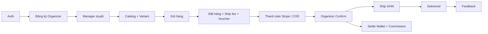
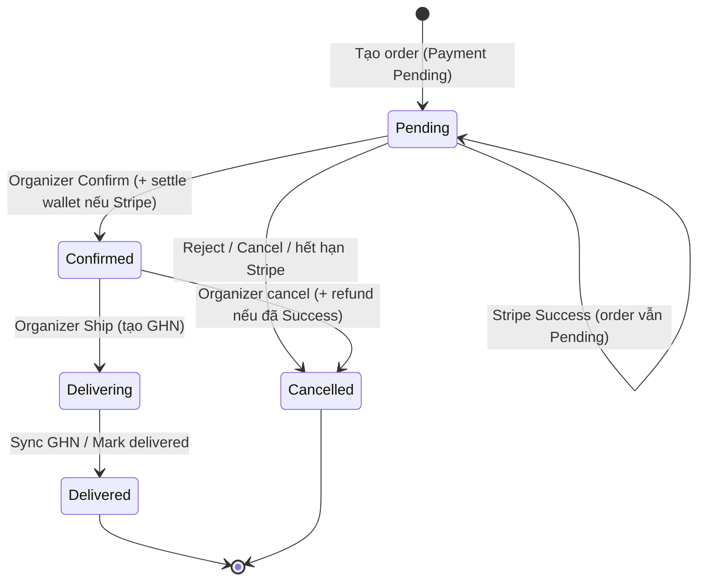
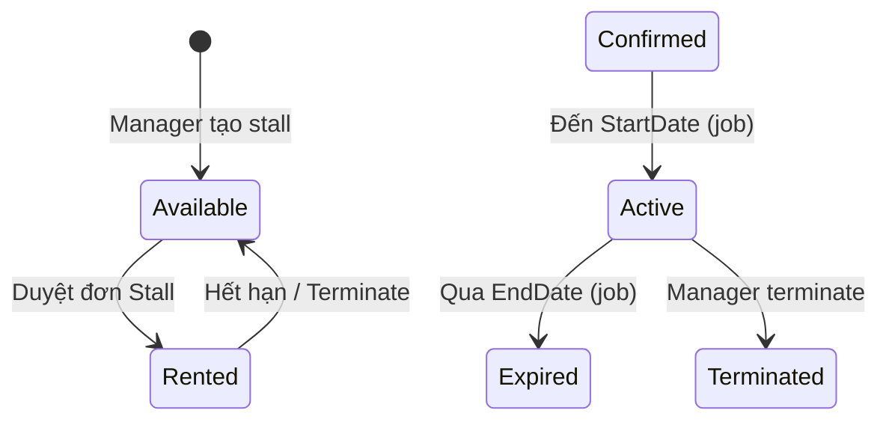

# MoonCake System – Tài liệu Requirement (bản cập nhật)

> Phạm vi: toàn bộ flow nghiệp vụ của sàn thương mại bánh trung thu nhiều gian hàng (multi-stall marketplace).
> Tài liệu phản ánh **logic đã chốt và đang chạy trong code** (Domain / Application / API), kèm phần còn bổ sung.
> Tên entity / enum khớp `MoonCake.Domain`. API: route kebab-case số nhiều, response `ApiResult<T>`, lỗi nghiệp vụ `ErrorHelper`.

---

## Mục lục

1. [Tổng quan hệ thống](#1-tổng-quan-hệ-thống)
2. [Actor & phân quyền](#2-actor--phân-quyền)
3. [Bảng trạng thái (Enum)](#3-bảng-trạng-thái-enum)
4. [Quy tắc nghiệp vụ chung](#4-quy-tắc-nghiệp-vụ-chung)
5. [Chi tiết các flow](#5-chi-tiết-các-flow)
6. [Danh sách chức năng tổng hợp](#6-danh-sách-chức-năng-tổng-hợp)
7. [Yêu cầu phi chức năng](#7-yêu-cầu-phi-chức-năng)
8. [Đã chốt / còn bổ sung](#8-đã-chốt--còn-bổ-sung)

---

## 1. Tổng quan hệ thống

MoonCake System là sàn bán bánh trung thu, nơi:

- **Manager** quản trị sàn: gian hàng, duyệt Organizer, voucher sàn, event sàn, đình chỉ Organizer.
- **Organizer** (`UserRole.Organization`): thuê gian hàng và/hoặc bán online; quản lý catalog (loại bánh, nhân, sản phẩm, variant, hộp combo), voucher gian hàng, xử lý đơn, địa chỉ lấy hàng GHN, xem ví.
- **User**: mua hàng, quản lý nhiều địa chỉ nhận, claim voucher, thanh toán Stripe hoặc COD, đánh giá, theo dõi đơn.

Vòng đời chính:



---

## 2. Actor & phân quyền

| Actor | Mô tả | Nhận diện |
|---|---|---|
| Guest | Chưa đăng nhập | Không token |
| User | Khách hàng | `User.Role = User` |
| Organizer | Người bán | `User.Role = Organization` + hồ sơ `Organizer` |
| Manager | Quản trị sàn | `User.Role = Manager` |
| System | Background job / webhook | — |

Ghi chú:

- Đăng ký mới luôn `Role = User`. Khi đơn Organizer có hiệu lực → `Role = Organization`.
- JWT dùng role string `Organization` (không dùng `Organizer`).
- Organizer vẫn mua hàng như User.
- Organizer `Suspended` giữ role nhưng bị chặn thao tác bán / tạo voucher / nhận đơn mới.

---

## 3. Bảng trạng thái (Enum)

| Enum | Giá trị | Ý nghĩa |
|---|---|---|
| `UserStatus` | `Active`, `Locked` | Tài khoản hoạt động / khóa |
| `UserRole` | `User`, `Manager`, `Organization` | Vai trò |
| `OrganizerStatus` | `Active`, `Suspended` | Hồ sơ Organizer |
| `StallStatus` | `Available`, `Rented` | Gian hàng trống / đang thuê |
| `RegistrationType` | `Stall`, `Online` | Thuê gian / bán online |
| `RegistrationStatus` | `Pending`, `AwaitingConfirmation`, `Approved`, `Rejected`, `Cancelled` | Vòng đời đơn đăng ký |
| `RentalStatus` | `Confirmed`, `Active`, `Expired`, `Terminated` | Hợp đồng thuê |
| `ProductStatus` | `Draft`, `Active`, `Inactive` | Nháp / Đang bán / Ẩn (Product & BoxItem) |
| `VoucherScope` | `Platform`, `Organizer` | Voucher sàn / gian hàng |
| `DiscountType` | `Percent`, `Fixed` | % / số tiền cố định |
| `VoucherStatus` | `Active`, `Inactive`, `Expired` | Trạng thái voucher |
| `OrderStatus` | `Pending`, `Confirmed`, `Delivering`, `Delivered`, `Cancelled` | Vòng đời đơn |
| `OrderItemType` | `Product`, `Box` | Dòng bánh lẻ / hộp combo |
| `PaymentMethod` | `Stripe`, `CashOnDelivery` | Phương thức thanh toán |
| `PaymentStatus` | `Pending`, `Success`, `Failed`, `Cancelled`, `Refunded` | Trạng thái thanh toán |
| `WalletTransactionType` | `OrderEarning`, `OrderReversal`, `TopUp`, `Payment`, `Refund` | Loại giao dịch ví (`TopUp`/`Payment`/`Refund` đã có enum, API chưa làm) |
| `CommissionStatus` | `Pending`, `Settled` | Hoa hồng |
| `FeedbackStatus` | `Visible`, `Hidden` | Đánh giá |
| `AddressOwnerType` | `User`, `Organizer`, `Stall` | Chủ sở hữu địa chỉ GHN |
| `NotificationType` | Order*, Organizer*, Registration*, StallRental*… | Loại thông báo |
| `NotificationChannel` | `Email`, `Realtime` | Kênh gửi |

### Vòng đời đơn hàng + thanh toán



### Vòng đời gian hàng & hợp đồng



---

## 4. Quy tắc nghiệp vụ chung

| Mã | Quy tắc |
|---|---|
| BR-01 | Email tài khoản duy nhất; mật khẩu luôn hash, không trả về client. |
| BR-02 | Soft delete (`IsDeleted`, `DeletedAt`, `DeletedBy`) cho dữ liệu nghiệp vụ. |
| BR-03 | Hợp đồng thuê `Confirmed`/`Active` của cùng stall không trùng thời gian (`StartDate mới ≤ EndDate cũ` và `EndDate mới ≥ StartDate cũ`). |
| BR-04 | Chỉ Organizer có đơn Online `Approved` mới bán qua hệ thống (sản phẩm / hộp / voucher / nhận đơn). Thuê stall = quyền gian vật lý; hoa hồng chỉ theo Online. |
| BR-05 | **Giá nằm trên `ProductVariant`**, không trên `Product`. Mỗi variant = 1 cặp `(CategoryId, FillingId)` + `Price`, unique theo product. |
| BR-06 | Khi đặt hàng, client gửi `ProductId + CategoryId + FillingId + Quantity`; hệ thống **đối chiếu variant** để lấy `UnitPrice` (không gửi `VariantId`). |
| BR-07 | Mỗi `Order` thuộc **một cặp `(OrganizerId, StallId)`** (`StallId` có thể null = online). Giỏ nhiều organizer/stall → nhiều order. |
| BR-08 | Mỗi order áp tối đa **1 voucher sàn + 1 voucher gian hàng**. Voucher phải đã claim vào `UserVoucher`. Giảm giá tuần tự trên số còn lại; `TotalAmount = max(0, Subtotal − PlatformDiscount − OrganizerDiscount) + ShippingFee`. |
| BR-09 | Snapshot giá vào `OrderItem.UnitPrice` lúc đặt. Dòng hộp: `Quantity = 1`; mua 2 hộp = 2 dòng. Tổng `OrderBoxSelection.Quantity` = `BoxItem.Capacity`. |
| BR-10 | Product/Box gắn **nhiều stall** (many–many). 0 stall = online-only; 1 stall = auto chọn; ≥2 stall = User phải chọn `StallId` khi thêm giỏ / đặt. |
| BR-11 | `CakeCategory` và `Filling` thuộc **từng Organizer** (không còn catalog Manager toàn cục). |
| BR-12 | Cart lưu lựa chọn mua: Product → `CategoryId` + `FillingId` + `Quantity` + `UnitPrice` (snapshot từ `ProductVariant`); Box → `Quantity` + `UnitPrice` (từ `BoxItem.Price`), Category/Filling null — selection trong hộp vẫn chọn lúc checkout. Không nhận giá từ client. |
| BR-13 | Stripe: **một lần checkout chỉ 1 nhóm** (1 organizer + 1 stall). COD tạo Payment kèm order nhưng chưa có luồng checkout riêng. |
| BR-14 | Phí ship GHN tính lúc tạo order, **User trả**, cộng vào `TotalAmount`. Điểm lấy hàng luôn từ **địa chỉ Organizer** (`ShippingAddress` OwnerType=Organizer), không từ Stall. |
| BR-15 | Địa chỉ dùng chung entity `ShippingAddress` theo `OwnerType` + `OwnerId`: User nhiều địa chỉ (có `IsDefault`); Organizer / Stall **mỗi bên tối đa 1 địa chỉ**. Stall vẫn giữ `Location` text hiển thị; address GHN dùng cho ship. |
| BR-16 | Thanh toán Stripe Success **không** settle ví ngay. Settle khi Organizer **Confirm**: `OrderAmount = Subtotal − OrganizerDiscount`; commission = round(`OrderAmount × Rate%`); organizer credit = `OrderAmount − Commission`. Rate từ đơn Online `Approved`. **Không settle COD.** |
| BR-17 | Buyer chỉ cancel khi `Pending` và Stripe **chưa** Success. Organizer cancel khi `Pending`/`Confirmed`; reject khi `Pending`. Refund Stripe + reverse wallet nếu đã settle. |
| BR-18 | Stripe chưa thanh toán quá **10 phút** → job hủy Payment + Order + hoàn voucher. |
| BR-19 | Mọi đổi trạng thái order ghi `OrderStatusHistory`. |
| BR-20 | Feedback: 1 lần / `OrderItem`, chỉ khi order `Delivered`. |
| BR-21 | Organizer `Suspended` / hết quyền Online: không tạo/sửa catalog & voucher, không nhận đơn mới; vẫn hoàn tất đơn cũ. |
| BR-22 | Organizer `Suspended` không gửi được đơn additional; đơn đang chờ của họ không duyệt / xác nhận được (409). |
| BR-23 | Organizer đã có hồ sơ khi đơn mới có hiệu lực: giữ nguyên hồ sơ cũ, không ghi đè bằng `BrandName` / `ContactPhone` / `BusinessInfo` trong đơn. Tạo mới thì `ContactEmail` lấy từ email User. |
| BR-24 | Cơ sở dữ liệu chặn 2 hợp đồng `Confirmed`/`Active` trùng thời gian trên cùng stall bằng constraint `EX_StallRentals_NoOverlap` (vi phạm → 409). |

---

## 5. Chi tiết các flow

---

### FLOW 1 – Đăng ký và đăng nhập

**Mục tiêu:** Có tài khoản hợp lệ, xác thực email, đăng nhập JWT.  
**Actor:** Guest, User.

**Luồng chính**

1. Guest đăng ký: email, mật khẩu, họ tên, SĐT → `User` (`Role=User`, `Status=Active`, chưa verify).
2. Hệ thống gửi OTP 6 số (5 phút); User verify OTP.
3. Đăng nhập email + mật khẩu → access token (~60′) + refresh token (~7 ngày).
4. Refresh / logout / quên–đặt lại mật khẩu.
5. User xem / cập nhật hồ sơ (`FullName`, `Phone`, `Address` text tùy chọn trên User).

**Ngoại lệ:** email trùng 409; OTP sai / hết hạn; tài khoản Locked / chưa verify; sai mật khẩu 401.

**API**

| Method | Route | Quyền |
|---|---|---|
| POST | `api/auth/register` | Public |
| POST | `api/auth/verify-otp` | Public |
| POST | `api/auth/resend-otp` | Public |
| POST | `api/auth/login` | Public |
| POST | `api/auth/refresh-token` | Public |
| POST | `api/auth/logout` | Auth |
| POST | `api/auth/forgot-password` | Public |
| POST | `api/auth/reset-password` | Public |
| GET/PUT | `api/users/me` | Auth |
| GET | `api/users`, `api/users/{id}` | Manager |

**Hậu điều kiện:** User đăng nhập được; FE dựa JWT role để hiện UI Organizer nếu `Organization`.

---

### FLOW 2 – Đăng ký làm Organizer

**Mục tiêu:** User/Organizer gửi đơn `Stall` hoặc `Online`.  
**Actor:** User, Organization.

**Luồng Stall (lần đầu – role User)**

1. Xem danh sách stall (`Available`/`Rented`, `RentalPrice`).
2. Gửi đơn: `BrandName`, `ContactPhone`, `BusinessInfo`, `StallId`, `StartDate`, `EndDate`.
3. Check: thời gian hợp lệ, không overlap rental BR-03, chưa có Pending cùng stall.
4. Tạo `OrganizerRegistration` (`Type=Stall`, `Pending`, `CommissionRate=null`).
5. Thông báo Manager.

**Luồng Online (lần đầu)**

1. Gửi đơn không stall / không thời hạn.
2. Chỉ được 1 Online đang `Pending` / `AwaitingConfirmation` / `Approved`.
3. Tạo registration `Type=Online`, `Pending`.

**Luồng phụ – đã là Organization**

- `POST .../additional-stalls`: thuê thêm nhiều stall cùng khoảng ngày (tối đa 10, không trùng list); thông tin lấy từ hồ sơ Organizer.
- `POST .../additional-online`: đăng ký thêm bán online nếu chưa có Online đang mở.

**Hủy đơn (chủ đơn)**

| Type | Được hủy khi |
|---|---|
| Stall | `Pending` |
| Online | `Pending` hoặc `AwaitingConfirmation` |

**API**

| Method | Route | Quyền |
|---|---|---|
| GET | `api/stalls`, `api/stalls/{id}` | Public |
| POST | `api/organizer-registrations` | User |
| POST | `api/organizer-registrations/additional-stalls` | Organization |
| POST | `api/organizer-registrations/additional-online` | Organization |
| GET | `api/organizer-registrations/me` | Auth |
| PUT | `api/organizer-registrations/{id}/cancel` | Chủ đơn |

---

### FLOW 3 – Manager duyệt Organizer + hồ sơ Organizer

**Mục tiêu:** Duyệt / từ chối; Online là duyệt hai chiều.  
**Actor:** Manager, chủ đơn.

**Duyệt Stall (1 transaction)**

1. Tạo/reuse `Organizer`, promote `User.Role → Organization`.
2. Tạo `StallRental` (`Active` nếu StartDate ≤ hôm nay VN, else `Confirmed`).
3. `Stall.Status = Rented`; registration `Approved`.
4. Auto-reject các Pending cùng stall **giao nhau thời gian**.
5. Thông báo OrganizerApproved.

**Duyệt Online (hai chiều)**

1. Manager bắt buộc nhập `CommissionRate` (0–100) → status `AwaitingConfirmation`.
2. User **Confirm** → tạo/reuse Organizer, promote role, `Approved` (không tạo StallRental).
3. User **Cancel** nếu không đồng ý rate.

**Từ chối:** chỉ khi `Pending`, bắt buộc `RejectReason`.

**Ràng buộc khi duyệt**

- Đơn Stall không nhận `CommissionRate` (400); đơn Online bắt buộc có (400).
- Đơn Stall đã quá `StartDate` không duyệt được (409).
- Sau khi role đổi thành `Organization`, FE phải gọi `refresh-token` rồi kết nối lại SignalR để token và nhóm realtime nhận role mới.
- Khi User xác nhận đơn Online, Manager nhận thông báo realtime; User hủy đơn cũng vậy.

**Hồ sơ Organizer**

- Organizer: GET/PUT `api/organizers/me` (partial update brand/contact/business).
- Địa chỉ lấy hàng: GET/PUT `api/organizers/me/address` (1 địa chỉ GHN – bắt buộc trước khi nhận đơn ship).
- Manager: list/detail, PUT status Suspended/Active (Suspended bắt buộc lý do).
- Organizer xem hợp đồng: `GET api/stall-rentals/me`.

**API duyệt**

| Method | Route | Quyền |
|---|---|---|
| GET | `api/organizer-registrations` | Manager |
| GET | `api/organizer-registrations/{id}` | Manager |
| PUT | `api/organizer-registrations/{id}/approve` | Manager |
| PUT | `api/organizer-registrations/{id}/reject` | Manager |
| PUT | `api/organizer-registrations/{id}/confirm` | Chủ đơn |

---

### FLOW 4 – Manager quản lý gian hàng & hợp đồng

**Mục tiêu:** CRUD stall; xem / chấm dứt hợp đồng.  
**Actor:** Manager.

**Luồng**

1. Tạo stall: `Code` (unique), `Name`, `Location` (text hiển thị), `RentalPrice`, `Description`; kèm **1 ShippingAddress OwnerType=Stall** (cấu trúc GHN). Mặc định `Available`.
2. Sửa / xóa mềm (chỉ khi Available và không còn rental).
3. Xem lịch sử thuê theo stall; list toàn bộ rentals.
4. Terminate hợp đồng Active → Flow 15.

**API**

| Method | Route | Quyền |
|---|---|---|
| POST/PUT/DELETE | `api/stalls`, `api/stalls/{id}` | Manager |
| GET | `api/stalls/{id}/rentals` | Manager |
| GET | `api/stall-rentals`, `api/stall-rentals/{id}` | Manager |
| PUT | `api/stall-rentals/{id}/terminate` | Manager |

---

### FLOW 5 – Catalog Organizer: Category, Filling, Product, Variant, Box

**Mục tiêu:** Organizer dựng catalog bán hàng.  
**Actor:** Organization (có Online Approved / không Suspended).  
**Tiền điều kiện:** Hồ sơ Organizer Active; bán qua hệ thống cần Online Approved.

#### 5.1 Loại bánh & nhân (theo Organizer)

- CRUD `CakeCategory`, `Filling` thuộc Organizer hiện tại.
- Tên unique trong phạm vi Organizer.
- Không xóa Category/Filling nếu còn Variant đang dùng.

#### 5.2 Product

- Tạo product = `Draft`; gắn nhiều ảnh (`ProductImage`: Url, SortOrder, IsPrimary).
- Gán stall: chỉ stall đang `StallRental.Active`; list rỗng = online-only.
- Đổi status: `Draft` ↔ `Active` ↔ `Inactive`.
- **Không có Category/Filling/Price trên Product.**

#### 5.3 ProductVariant

- Mỗi variant: `ProductId + CategoryId + FillingId + Price`.
- Category & Filling phải cùng Organizer với Product.
- Không trùng cặp Category×Filling trên cùng Product.
- Khi order: client chọn Category + Filling → hệ thống match variant lấy giá.

Ví dụ:

| Product | Category | Filling | Price |
|---|---|---|---|
| Bánh A | Nướng | Đậu xanh | 10.000 |
| Bánh A | Nướng | Thập cẩm | 15.000 |
| Bánh A | Dẻo | Đậu xanh | 10.000 |

#### 5.4 BoxItem (hộp combo)

- `Name`, `Capacity`, `Price` cố định cả hộp, ảnh nhiều (`BoxImage`), gán Products thuộc Organizer, gán Stalls tương tự Product.
- `available-products`: bánh Active cùng organizer (và stall nếu filter).

**API**

| Resource | Public | Organization |
|---|---|---|
| `api/cake-categories` | GET list/detail | me, POST, PUT, DELETE |
| `api/fillings` | GET | me, POST, PUT, DELETE |
| `api/products` | GET | me, CRUD, PUT stalls, PUT status |
| `api/product-variants` | GET | POST, PUT, DELETE |
| `api/box-items` | GET, available-products | me, CRUD, stalls, status |

---

### FLOW 6 – Voucher gian hàng (Organizer)

**Mục tiêu:** Organizer phát hành voucher scope Organizer.  
**Tiền điều kiện:** Có Online Approved; không Suspended.

**Luồng:** tạo mã, loại giảm, mức giảm, max discount (nếu %), min order, thời hạn, usage limit / per user → `Scope=Organizer`.  
Sửa / bật–tắt / xóa (chỉ khi `UsedCount=0`).

**API:** `POST api/vouchers/organizer`, `GET api/vouchers/me`, PUT/DELETE chung theo quyền chủ voucher.

---

### FLOW 7 – Voucher sàn (Manager) & claim (User)

**Mục tiêu:** Manager tạo voucher Platform; User claim vào ví voucher rồi mới áp lúc đặt.

**Luồng**

1. Manager tạo `Scope=Platform`.
2. User xem `available` → `POST {id}/claim` → `UserVoucher`.
3. Xem đã claim: `GET api/vouchers/my`; bỏ claim: `DELETE api/vouchers/my/{userVoucherId}`.

**API thêm:** `GET/POST api/vouchers` (Manager), `POST api/vouchers/platform`, `GET available`, claim/my.

---

### FLOW 8 – Giỏ hàng (Cart)

**Mục tiêu:** User lưu sản phẩm/hộp muốn mua kèm biến thể, số lượng và giá snapshot.  
**Actor:** Auth user.

**Luồng**

1. Thêm product: `ProductId` + `CategoryId` + `FillingId` + `Quantity` + optional `StallId` (resolve stall: 0 → null; 1 → auto; ≥2 → bắt buộc StallId thuộc product). Hệ thống match `ProductVariant` → `UnitPrice = variant.Price` (không nhận giá từ client).
2. Thêm box: `BoxItemId` + `Quantity` + optional `StallId`; `UnitPrice = BoxItem.Price`. Category/Filling = null; chọn bánh trong hộp lúc checkout.
3. Trùng cùng khóa unique → cộng dồn `Quantity` (không tạo dòng mới):
   - Product: `(CartId, ProductId, CategoryId, FillingId, StallId)`
   - Box: `(CartId, BoxItemId, StallId)`
4. Xem giỏ nhóm theo Organizer + Stall; dùng `UnitPrice` / `Quantity` đã lưu trên dòng.
5. Có thể cập nhật `Quantity` (và với Product có thể đổi Category/Filling → re-resolve giá variant). Xóa từng dòng.

**API**

| Method | Route |
|---|---|
| GET | `api/carts/me` |
| POST | `api/carts/items/product` |
| POST | `api/carts/items/box` |
| PUT | `api/carts/items/{itemId}` |
| DELETE | `api/carts/items/{itemId}` |

---

### FLOW 9 – Đặt hàng (Order) + voucher + phí ship

**Mục tiêu:** Tạo 1..n order từ request trực tiếp hoặc từ cart.  
**Actor:** User (buyer).

**Input bắt buộc**

- `ShippingAddressId` (OwnerType=User của buyer).
- `PaymentMethod` (`Stripe` | `CashOnDelivery`).
- `POST /orders` (trực tiếp): Product gửi `ProductId`, `CategoryId`, `FillingId`, `Quantity`, optional `StallId`; Box gửi `BoxItemId`, `Selections[{ProductId, CategoryId, FillingId, Quantity}]`, optional `StallId`.
- `POST /orders/from-cart`: gửi danh sách `CartItemId` đã chọn (+ địa chỉ / payment / voucher). Product lấy Category/Filling/Quantity/UnitPrice từ cart (có thể re-validate variant còn tồn tại); Box lấy Quantity/UnitPrice từ cart, vẫn cần `Selections` trong request.
- Optional voucher ids đã claim.

**Luồng chính**

1. Load địa chỉ nhận → snapshot `Receiver*`, `ToProvince/Ward`, `AddressDetail`, `ShippingAddress` text.
2. Prepare từng dòng:
   - Product Active + tồn tại Variant khớp Category×Filling → `UnitPrice = variant.Price`.
   - Box Active; Σ selection = Capacity; mỗi selection thuộc box + có variant → `UnitPrice = Box.Price`, `Quantity=1`.
3. Group theo `(OrganizerId, StallId)` → mỗi group 1 Order + OrderCode.
4. Nếu `PaymentMethod=Stripe` và >1 group → **409 Conflict** (chỉ 1 nhóm / lần Stripe).
5. Áp voucher đã claim: kiểm Active, hạn, usage, min subtotal, đúng organizer; tính `PlatformDiscount` / `OrganizerDiscount`.
6. Tính `ShippingFee` GHN: **From = địa chỉ Organizer**, To = địa chỉ buyer; insurance theo merchandise sau giảm (cap theo GHN). Organizer chưa có address → lỗi.
7. `TotalAmount = max(0, Subtotal − discounts) + ShippingFee`.
8. Tạo Order `Pending`, Items (+ BoxSelections), StatusHistory, Payment `Pending` cùng method.
9. Consume voucher (`UsedCount++`, soft-remove UserVoucher, ghi VoucherUsage).
10. Notify OrderCreated. Nếu `from-cart` → soft-remove các cart item đã đặt.

**API**

| Method | Route | Mô tả |
|---|---|---|
| POST | `api/orders` | Tạo trực tiếp |
| POST | `api/orders/from-cart` | Checkout từ giỏ |
| GET | `api/orders/me` | Đơn của tôi |
| GET | `api/orders/{id}` | Chi tiết (buyer / organizer đơn) |

---

### FLOW 10 – Thanh toán (Stripe / COD) + hết hạn

**Mục tiêu:** Thu tiền đơn Stripe; COD ghi nhận method khi tạo order.  
**Actor:** User, Stripe webhook, System.

**Luồng Stripe**

1. `POST api/payments/checkout` với Payment/Order Pending → Stripe Checkout Session (cửa sổ **10 phút**).
2. User thanh toán → webhook / return / sync → `Payment.Status = Success` (**Order vẫn Pending**).
3. User cancel session / hết hạn → Payment Cancelled/Failed; job hết hạn cũng hủy Order + restore voucher.
4. Refund: khi Organizer reject/cancel sau Success → Stripe refund + `Payment.Refunded` + reverse wallet nếu đã settle.

**COD:** Payment tạo kèm order ở `Pending`; chưa có API checkout COD riêng (ghi chú “not supported yet” trên checkout Stripe-only).

**API**

| Method | Route |
|---|---|
| POST | `api/payments/checkout` |
| GET | `api/payments/{id}` |
| POST | `api/payments/{id}/sync` |
| PATCH | `api/payments/{id}/cancel` |
| GET | `api/payments/stripe-return` / `stripe-cancel` |
| POST | `api/payments/stripe-webhook` |

**Job:** `UnpaidPaymentExpireWorker` — hủy đơn Stripe quá 10 phút chưa Success.

---

### FLOW 11 – Organizer xử lý đơn + GHN

**Mục tiêu:** Confirm → Ship (GHN) → Delivered; hoặc Reject/Cancel.  
**Actor:** Organization (chủ order).

| Action | Điều kiện | Hậu quả |
|---|---|---|
| Confirm | Pending; nếu Stripe thì Payment phải Success | → Confirmed; **settle wallet + commission** (chỉ Stripe) |
| Reject | Pending | → Cancelled; refund nếu Payment Success; restore voucher nếu chưa trả |
| Cancel (Organizer) | Pending hoặc Confirmed | → Cancelled; refund/reverse tương tự |
| Cancel (Buyer) | Chỉ Pending và Stripe **chưa** Success | → Cancelled + restore voucher |
| Ship | Confirmed | Tạo vận đơn GHN; COD amount = Total nếu COD; → Delivering; lưu `GhnOrderCode` |
| Sync shipping | Delivering | Đồng bộ trạng thái GHN |
| Mark delivered | Delivering | → Delivered, `DeliveredAt` |

Mỗi bước ghi `OrderStatusHistory` + thông báo realtime.

**API**

| Method | Route |
|---|---|
| GET | `api/orders/organizer/me` |
| POST | `api/orders/{id}/confirm` |
| POST | `api/orders/{id}/reject` |
| POST | `api/orders/{id}/cancel` |
| POST | `api/orders/{id}/ship` |
| POST | `api/orders/{id}/sync-shipping` |
| POST | `api/orders/{id}/mark-delivered` |

---

### FLOW 12 – Địa chỉ giao hàng & ước tính phí GHN

**Mục tiêu:** Quản lý địa chỉ có cấu trúc tỉnh/phường GHN; ước phí trước khi đặt.  
**Actor:** User, Organization, Manager (qua Stall).

**Mô hình `ShippingAddress`**

| OwnerType | Số lượng | API quản lý | Vai trò |
|---|---|---|---|
| User | Nhiều; có `IsDefault` | `api/shipping-addresses` | Địa chỉ nhận hàng |
| Organizer | Đúng 1 | `api/organizers/me/address` | Điểm lấy hàng (pickup) khi tạo order / ship |
| Stall | Đúng 1 | Gắn khi Manager CRUD Stall | Lưu sẵn; **hiện không dùng làm pickup order** |

Field: Label?, ReceiverName/Phone, ProvinceId/Name, WardId/Name, AddressDetail.

**Giả định đã chốt:** giữ `Stall.Location` (text hiển thị) **và** address GHN của Stall; phí ship order lấy From = Organizer address.

**API shipping**

| Method | Route | Việc |
|---|---|---|
| GET | `api/shipping/provinces` | Danh sách tỉnh GHN |
| GET | `api/shipping/wards?provinceId=` | Phường/xã |
| POST | `api/shipping/fee` | Ước phí (to address hoặc ShippingAddressId) |
| CRUD | `api/shipping-addresses` | Địa chỉ của User |

---

### FLOW 13 – Ví nội bộ (Wallet) & hoa hồng

**Mục tiêu:** Ghi nhận tiền Organizer sau Confirm Stripe; trừ hoa hồng sàn.  
**Actor:** System (settle), User/Organizer xem số dư.

**Mô hình**

- Mỗi User có tối đa 1 `Wallet` (`AvailableBalance`, VND).
- `WalletTransaction`: Amount có dấu, `BalanceAfter`, gắn `OrderId` / `CommissionId` tùy loại.

**Settle khi Confirm (Stripe only)**

```
OrderAmount       = max(0, SubtotalAmount − OrganizerDiscount)   // không trừ PlatformDiscount, không trừ ShippingFee
CommissionAmount  = min(OrderAmount, Round(OrderAmount × Rate / 100))
OrganizerEarning  = OrderAmount − CommissionAmount
```

- Rate từ đơn Online `Approved` mới nhất có `CommissionRate`.
- Tạo `Commission` (trong code settle ghi Settled ngay) + tx `OrderEarning` (+earning vào ví Organizer = User của Organizer).
- Refund/reject sau settle → `OrderReversal` (cần đủ số dư).

**API hiện có**

| Method | Route |
|---|---|
| GET | `api/wallets/me` |
| GET | `api/wallets/me/transactions` |

**Chưa làm:** TopUp / trừ Payment bằng ví / rút tiền; không có controller Commission riêng.

---

### FLOW 14 – Đánh giá (Feedback)

**Mục tiêu:** User đánh giá từng `OrderItem` sau Delivered.  
**Actor:** User.

**Luồng:** order Delivered + thuộc user + item chưa feedback → Rating 1–5, Comment?, ảnh → `Visible`.

**API hiện có:** `GET api/feedbacks/me`, `GET api/feedbacks/{id}`, `POST api/feedbacks`.  
**Chưa làm:** Organizer reply; Manager ẩn/hiện; list public theo product.

---

### FLOW 15 – Kết thúc hợp đồng thuê

**Mục tiêu:** Giải phóng stall khi hết hạn / terminate.  
**Actor:** System (job), Manager.

**Luồng**

1. Job: `Confirmed` → `Active` khi đến StartDate; `Active` → `Expired` khi qua EndDate; hủy registration Stall quá hạn StartDate.
2. Manager terminate Active → `Terminated`.
3. Gỡ Product/Box khỏi stall; nếu không còn stall nào → product/box `Inactive`; nếu organizer không còn rental → inactive voucher organizer (theo rule hiện tại).
4. Stall về `Available` nếu không còn rental khác.
5. Đơn đang xử lý vẫn hoàn tất; Organizer giữ `Role=Organization`.

**API:** `PUT api/stall-rentals/{id}/terminate` + `StallRentalStatusWorker`.

---

### FLOW 16 – Event (banner / sự kiện)

**Mục tiêu:** Marketing event sàn hoặc của Organizer.  
**Actor:** Manager (platform: `OrganizerId=null`), Organization (event của mình), Public xem.

**Entity:** `Event` + `EventImage`; status Draft/Published/Ended/Cancelled.

**API:** `GET api/events`, `GET api/events/me`, `GET/{id}`, POST/PUT/DELETE theo owner.

---

### FLOW 17 – Thông báo

**Mục tiêu:** Realtime + email theo sự kiện.  
**Actor:** Auth user; System worker gửi email.

- Realtime gửi ngay; Email qua `NotificationEmailWorker` (Pending → Sent).
- API: list, unread-count, mark read 1 / nhiều (`api/notifications`).

---

## 6. Danh sách chức năng tổng hợp

| Module | Chức năng chính | Flow | Actor |
|---|---|---|---|
| Auth / User | Đăng ký, OTP, login, refresh, logout, quên MK, hồ sơ | 1 | Guest, User, Manager |
| Stall / Rental | CRUD stall (+ address GHN), rentals, terminate, job hết hạn | 2, 4, 15 | Manager, System |
| Organizer Registration | Stall/Online, additional, duyệt 2 chiều, hủy | 2, 3 | User, Org, Manager |
| Organizer | Hồ sơ, address pickup, suspend | 3 | Org, Manager |
| Catalog | Category, Filling, Product, Variant, Box, Images, gán stall | 5 | Org, Public |
| Voucher | Platform / Organizer, claim, apply lúc order | 6, 7, 9 | Manager, Org, User |
| Cart | Thêm product (C+F+SL) / box + stall, cập nhật SL, xem, xóa | 8 | User |
| Order | Create / from-cart, confirm/reject/cancel/ship/deliver | 9, 11 | User, Org |
| Shipping | Provinces/wards/fee, ShippingAddress User | 12 | Auth |
| Payment | Stripe checkout, webhook, sync, expire job | 10 | User, System |
| Wallet | Số dư, lịch sử; settle/reversal khi confirm/refund | 13 | Org/User, System |
| Feedback | Đánh giá order item sau Delivered | 14 | User |
| Event | CRUD event sàn / organizer | 16 | Manager, Org, Public |
| Notification | List, đọc, realtime + email worker | 17 | Auth, System |

### Theo actor (tóm tắt)

- **Guest:** đăng ký/login; xem stall, product, box, event, category/filling public.
- **User:** địa chỉ nhận, giỏ, đặt hàng, claim voucher, Stripe, hủy Pending (chưa trả), feedback, thông báo.
- **Organization:** catalog + variant, voucher org, address pickup, xử lý đơn + GHN, ví, event riêng, thuê thêm stall / online.
- **Manager:** stall, duyệt registration, suspend organizer, voucher sàn, event sàn, terminate rental.
- **System:** hết hạn Stripe, cập nhật rental, gửi email.

---

## 7. Yêu cầu phi chức năng

| Mã | Yêu cầu |
|---|---|
| NFR-01 | JWT access + refresh; phân quyền `[Authorize(Roles=...)]`. |
| NFR-02 | Thao tác nhiều bước (duyệt Organizer, tạo order, confirm+settle, ship, hủy+refund) trong transaction. |
| NFR-03 | Validate FluentValidation trước controller; lỗi `ApiResult`. |
| NFR-04 | Soft delete + audit fields trên BaseEntity. |
| NFR-05 | Tiền `decimal`, round VND (0 chữ số) khi % discount; commission round 2 nơi settle. |
| NFR-06 | Phân trang chuẩn `Pagination<T>`. |
| NFR-07 | SwaggerOperation Summary/Description tiếng Anh mọi action. |
| NFR-08 | Email bất đồng bộ; lỗi gửi không rollback nghiệp vụ. |
| NFR-09 | Tích hợp GHN (province/ward/fee/create order) và Stripe (Checkout + webhook). |

---

## 8. Đã chốt / còn bổ sung

| # | Nội dung | Trạng thái | Ghi chú |
|---|---|---|---|
| 1 | Role Organizer = `Organization` khi duyệt/confirm | Đã chốt + code | |
| 2 | Entity `Cart` / `CartItem` (không dùng OrderItem nháp) | Đã chốt + code | Product: Category+Filling+Qty+UnitPrice (variant); Box: Qty+UnitPrice |
| 3 | Organizer thuê nhiều stall; additional-stalls / additional-online | Đã chốt + code | |
| 4 | Auto-reject Pending trùng thời gian khi duyệt Stall | Đã chốt + code | |
| 5 | Hoa hồng chỉ Online; Stall chỉ giá thuê | Đã chốt + code | |
| 6 | Product/Box many–many Stall; online = 0 stall | Đã chốt + code | |
| 7 | ProductVariant = Category×Filling+Price; order chọn C+F | Đã chốt + code | Không gửi VariantId |
| 8 | Category/Filling thuộc Organizer | Đã chốt + code | |
| 9 | ProductImage / BoxImage; bỏ ImageUrl đơn | Đã chốt + code | |
| 10 | Event platform / organizer | Đã chốt + code | |
| 11 | ShippingAddress dùng chung User/Organizer/Stall | Đã chốt + code | Org/Stall max 1; User nhiều |
| 12 | Pickup GHN từ địa chỉ Organizer; Stall.Location giữ text | Đã chốt + code | |
| 13 | ShippingFee cộng TotalAmount; User trả ship | Đã chốt + code | |
| 14 | Stripe + wallet nội bộ; settle lúc Confirm | Đã chốt + code | Không settle COD |
| 15 | Stripe 1 nhóm (1 org+stall) / lần; timeout 10′ | Đã chốt + code | |
| 16 | Voucher claim rồi mới apply; max 1 platform + 1 organizer / order | Đã chốt + code | |
| 17 | Hủy buyer chỉ Pending & chưa Stripe Success | Đã chốt + code | |
| 18 | Tách order theo `(OrganizerId, StallId)` | Đã chốt + code | |
| 19 | Ban/unban quyền Online chi tiết API | Còn bổ sung | Hiện dùng Suspend Organizer |
| 20 | TopUp / Payment / Refund trên ví | Enum có, API chưa | |
| 21 | Organizer reply feedback / Manager ẩn / list public | Còn bổ sung | |
| 22 | Controller Commission báo cáo / đối soát tay | Còn bổ sung | Settle tự động khi Confirm |
| 23 | Checkout COD đầy đủ | Còn bổ sung | Payment COD tạo kèm order |
| 24 | Address text trên Organizer hồ sơ (ngoài ShippingAddress) | Hoãn | Dùng ShippingAddress |

---

## Phụ lục A – Công thức tiền trên Order

```
SubtotalAmount     = Σ OrderItem.Subtotal
PlatformDiscount   = giảm từ voucher sàn (sau khi áp tuần tự)
OrganizerDiscount  = giảm từ voucher gian hàng
ShippingFee        = phí GHN (User trả)
TotalAmount        = max(0, SubtotalAmount − PlatformDiscount − OrganizerDiscount) + ShippingFee

# Khi Confirm Stripe:
OrderAmount (commission base) = max(0, SubtotalAmount − OrganizerDiscount)
CommissionAmount              = Round(OrderAmount × Rate / 100)
OrganizerEarning              = OrderAmount − CommissionAmount
# ShippingFee và PlatformDiscount không vào ví Organizer / không vào base commission
```

## Phụ lục B – Sơ đồ dữ liệu catalog & order (rút gọn)

```
Organizer
 ├── CakeCategory, Filling
 ├── Product ──┬── ProductVariant (Category + Filling + Price)
 │            ├── ProductImage
 │            └── Stalls *
 ├── BoxItem ──┬── Products *
 │            ├── BoxImage
 │            └── Stalls *
 └── ShippingAddress (OwnerType=Organizer)  ← pickup GHN

User
 ├── Cart → CartItem (Product: C+F+Qty+UnitPrice | Box: Qty+UnitPrice + StallId?)
 ├── ShippingAddress * (OwnerType=User)
 ├── Wallet → WalletTransaction
 └── Order * → OrderItem (Category+Filling snapshot) / Payment / Commission
```

---

*Tài liệu này thay thế bản Requirements 15-flow cũ; các quyết định mới (Variant, Cart, Stripe/Wallet, GHN/ShippingAddress) đã được gộp vào từng flow tương ứng.*
